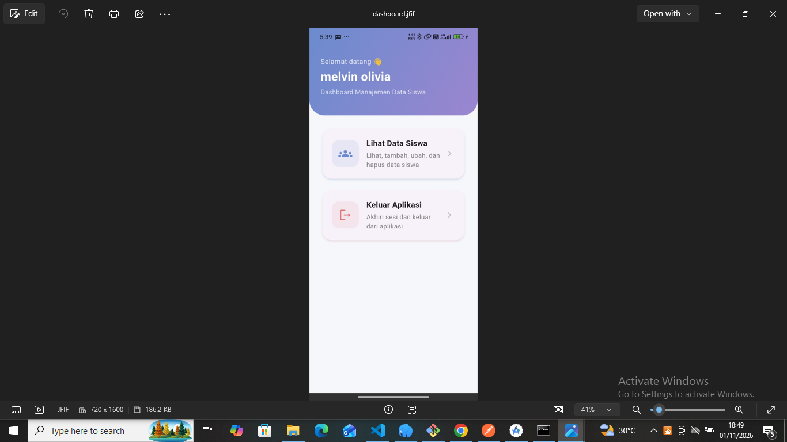
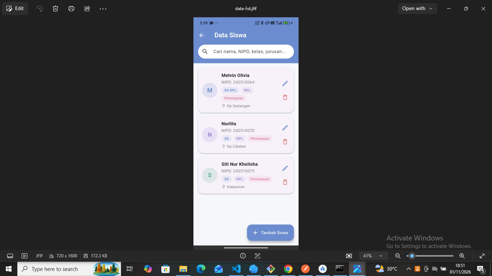
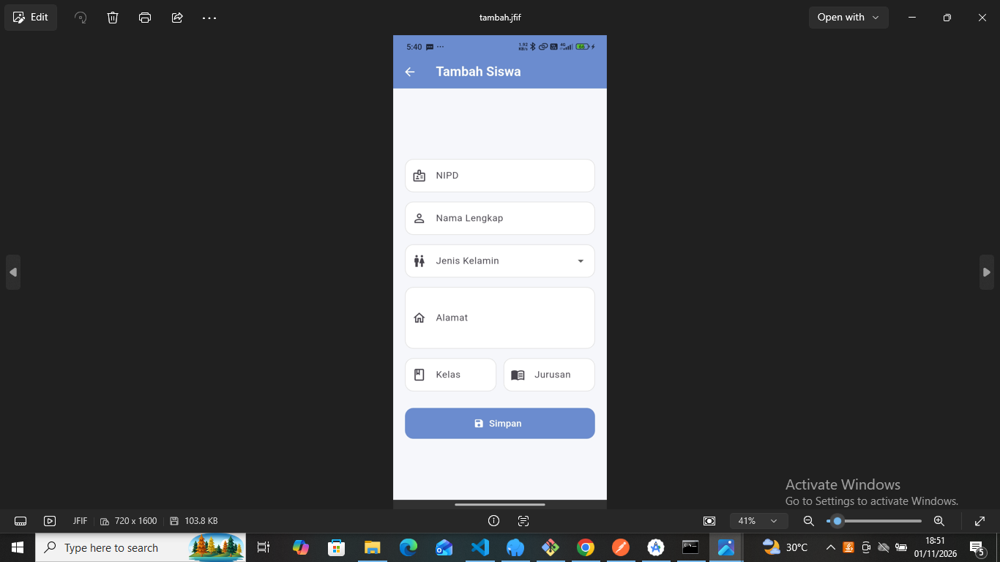
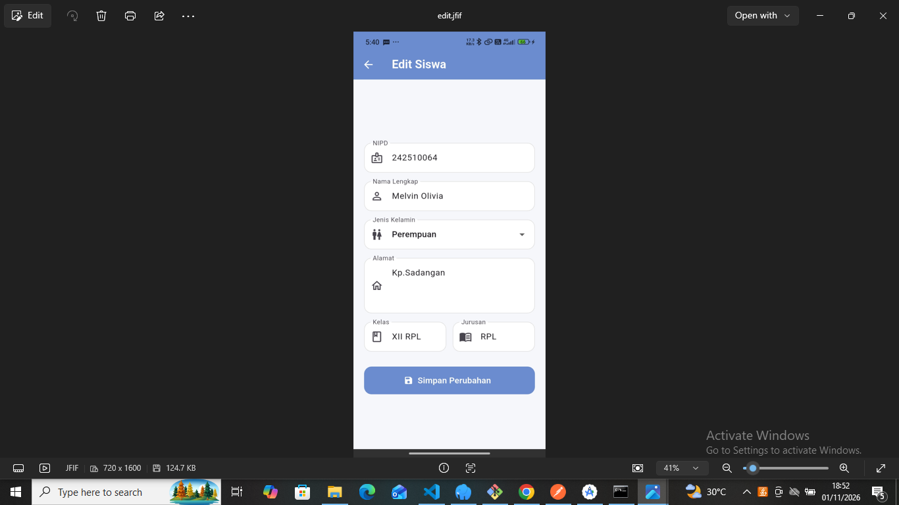
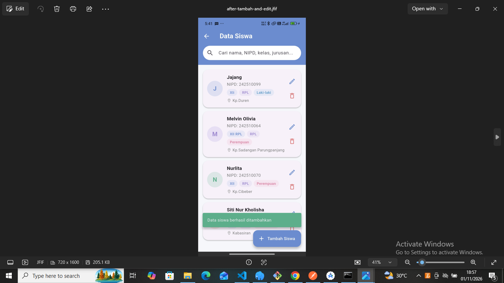
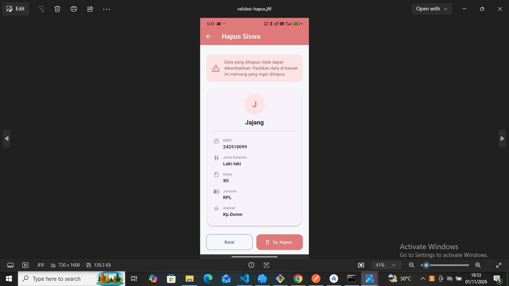
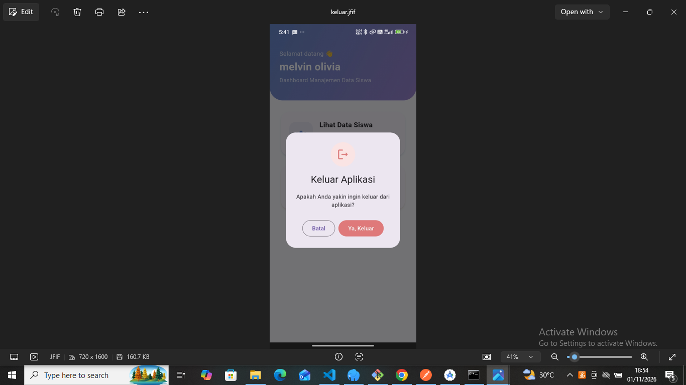
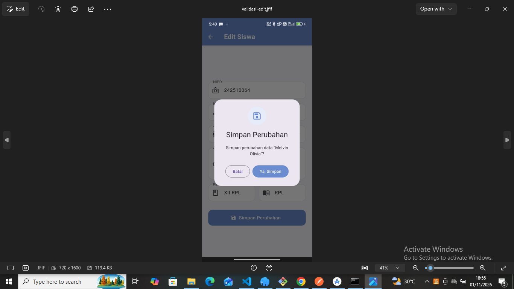

# Manajemen Data Siswa

Aplikasi manajemen data siswa untuk pengambilan nilai akhir. Backend berupa REST API (Express.js + MySQL) dan frontend berupa aplikasi Flutter yang bisa berjalan di web maupun HP (Android).

> **Nama Anggota:** Melvin Olivia & Robiyatun Nisa
> **Kelas:** XII RPL

---

## Fitur

- **Login** memakai email dan password yang terdaftar di tabel `user`, lengkap dengan validasi form dan pesan kesalahan dari server.
- **Dashboard** dengan 2 menu: **Lihat Data Siswa** dan **Keluar Aplikasi**.
- **Data siswa** tampil dalam bentuk list kartu, dilengkapi pencarian dan tarik layar untuk refresh.
- **Tambah, Edit, dan Hapus** siswa, masing-masing di halaman terpisah.
- **Validasi di setiap aksi**: validasi isian form, dialog konfirmasi sebelum menyimpan, dan halaman konfirmasi sebelum menghapus.
- **Keluar aplikasi** selalu memakai konfirmasi. Di web kembali ke halaman login, di HP aplikasi ditutup sesuai standar Android (tombol back di dashboard juga memunculkan konfirmasi).
- Tampilan icon mata pada password untuk menampilkan atau menyembunyikan password.

## Teknologi

| Bagian | Teknologi |
|---|---|
| Backend | Node.js, Express.js, mysql2, bcryptjs / bcrypt, cors, dotenv |
| Database | MySQL (Laragon), nama database `belajar_express` |
| Frontend | Flutter (Dart), package `http` |
| Pengujian API | Postman |
| Editor | Visual Studio Code |

## Struktur Folder

```
manajemen-data-siswa/
├── backend/
│   ├── .env
│   ├── package.json
│   ├── server.js
│   └── src/
│       ├── app.js                      <- setup express dan endpoint /login
│       ├── config/database.js          <- koneksi MySQL
│       ├── controllers/siswaController.js
│       ├── models/
│       │   ├── siswaModel.js
│       │   └── userModel.js
│       └── routes/siswaRoutes.js
├── frontend/
│   └── lib/
│       ├── main.dart                   <- alamat backend (baseUrl)
│       └── pages/
│           ├── page_login.dart
│           ├── page_dashboard.dart
│           ├── page_siswa.dart         <- list data siswa
│           ├── page_siswa_tambah.dart
│           ├── page_siswa_edit.dart
│           └── page_siswa_hapus.dart
├── postman/
│   └── siswa.postman_collection.json
├── screenshots/                        <- screenshot dari HP
├── belajar_express.sql
└── README.md
```

## Struktur Database

Database: `belajar_express`

**Tabel `user`** (untuk login)

| Kolom | Keterangan |
|---|---|
| id | Primary key, auto increment |
| nama | Nama pengguna |
| email | Email untuk login |
| password | Password |

**Tabel `siswa`**

| Kolom | Keterangan |
|---|---|
| id | Primary key, auto increment |
| nipd | Nomor induk peserta didik (unik) |
| nama_lengkap | Nama lengkap siswa |
| jenis_kelamin | ENUM `L` (laki-laki) atau `P` (perempuan) |
| alamat | Alamat siswa |
| kelas | Kelas |
| jurusan | Jurusan |

File `belajar_express.sql` berisi struktur dan data database yang bisa langsung diimpor.

## Cara Menjalankan

### 1. Database
1. Jalankan **Laragon** (Start All).
2. Buka HeidiSQL atau phpMyAdmin, lalu impor `belajar_express.sql` sehingga database `belajar_express` beserta tabel `user` dan `siswa` terbentuk.

### 2. Backend
```bash
cd backend
npm install
```
Buat file `.env` di folder `backend`:
```
PORT=3000
DB_HOST=localhost
DB_USER=root
DB_PASSWORD=
DB_NAME=belajar_express
```
Jalankan server:
```bash
npm start
```
Jika berhasil, terminal menampilkan `Server berjalan di http://localhost:3000` dan `Database terhubung`.

### 3. Frontend (Flutter)
```bash
cd frontend
flutter pub get
```
Buka `lib/main.dart`, lalu atur alamat backend pada `baseUrl` sesuai tempat aplikasi dijalankan:

| Tempat menjalankan | Nilai `baseUrl` |
|---|---|
| Web (Chrome) | `http://localhost:3000` |
| Emulator Android | `http://10.0.2.2:3000` |
| HP fisik | `http://IP-LAPTOP:3000` (IPv4 dari `ipconfig`, HP dan laptop harus satu WiFi) |

Jalankan aplikasi:
```bash
flutter run -d chrome     # web
flutter run               # emulator atau HP
```

Khusus Android, pastikan `android/app/src/main/AndroidManifest.xml` memiliki izin internet dan izin koneksi non-HTTPS:
```xml
<uses-permission android:name="android.permission.INTERNET"/>
<application android:usesCleartextTraffic="true" ... >
```

## Dokumentasi REST API

Base URL: `http://localhost:3000`

| Method | Endpoint | Fungsi |
|---|---|---|
| POST | `/login` | Login dengan email dan password |
| GET | `/siswa` | Ambil semua data siswa |
| GET | `/siswa/:id` | Ambil satu data siswa |
| POST | `/siswa` | Tambah data siswa |
| PUT | `/siswa/:id` | Ubah data siswa |
| DELETE | `/siswa/:id` | Hapus data siswa |

**Contoh body login**
```json
{
  "email": "admin@gmail.com",
  "password": "123456"
}
```

**Contoh body tambah dan edit siswa**
```json
{
  "nipd": "242510064",
  "nama_lengkap": "Melvin Olivia",
  "jenis_kelamin": "P",
  "alamat": "Kp.Sadangan",
  "kelas": "XII",
  "jurusan": "RPL"
}
```

**Bentuk response**
```json
{ "status": true, "message": "Data siswa berhasil ditambahkan", "data": { } }
```
Jika gagal, `status` bernilai `false` dan `message` berisi alasannya, misalnya `NIPD sudah terdaftar`.

**Validasi di backend:** semua isian wajib diisi, NIPD hanya angka dan tidak boleh kembar, nama hanya huruf, jenis kelamin harus `L` atau `P`, serta format email dicek saat login.

## Postman Collection

File koleksi ada di `manajemen-data-siswa/RestApi.postman_collection.json`.
1. Buka Postman, pilih **Import**, lalu pilih file tersebut.
2. Pastikan backend sedang berjalan.
3. Variabel `baseUrl` sudah berisi `http://localhost:3000`. Ubah jika alamat berbeda.
4. Jalankan request **Login**, lalu request lain (Get, Tambah, Edit, Hapus). Ubah variabel `siswaId` sesuai id siswa yang ingin diuji.

## Alur Aplikasi

1. **Login**: isi email dan password. Jika kosong atau format email salah, muncul pesan di bawah kolom. Jika email atau password tidak cocok, muncul pesan merah dari server.
2. **Dashboard**: menampilkan nama pengguna dan 2 menu.
3. **Lihat Data Siswa**: menampilkan semua siswa dalam bentuk list. Tersedia kolom cari, tombol **Tambah Siswa**, serta ikon **edit** dan **hapus** pada setiap kartu.
4. **Tambah Siswa**: isi form, tekan simpan, lalu konfirmasi. Data masuk ke database dan list diperbarui.
5. **Edit Siswa**: form terisi data lama, ubah, simpan, lalu konfirmasi.
6. **Hapus Siswa**: halaman konfirmasi menampilkan detail siswa dan peringatan, lalu tekan **Ya, Hapus**.
7. **Keluar Aplikasi**: muncul dialog konfirmasi. Di web kembali ke halaman login, di HP aplikasi ditutup.

## Screenshot (dari HP)

| Halaman | Screenshot |
|---|---|
| Login | ![Login] (image-1.png)| 
| Dashboard |  |
| Data Siswa |  |
| Tambah Siswa |  |
| Edit Siswa |  |
| after edit & tambah |  |
| Hapus Siswa |  |
| Konfirmasi Keluar Aplikasi |  |
| Validasi-validasi |  |  |